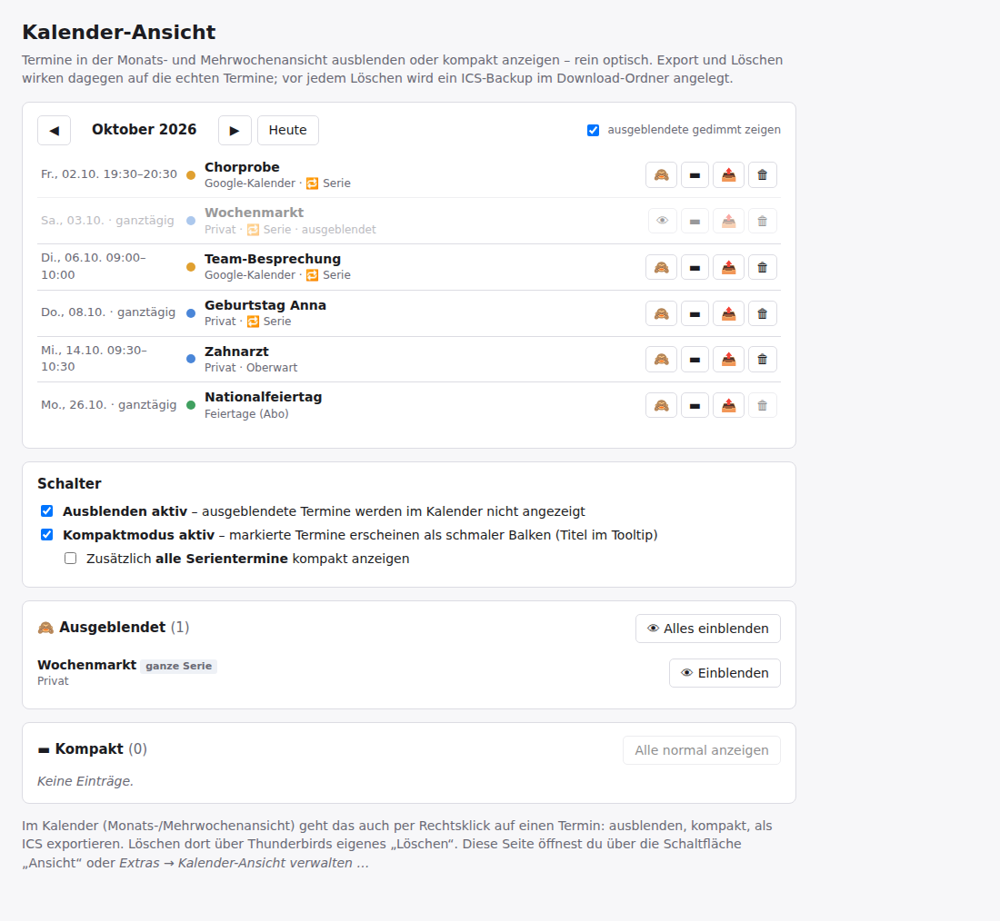

# Kalender-Ansicht (Calendar Hide & Compact)

Ein Thunderbird-Add-on, das Termine, Serien oder einzelne Vorkommen in der Monatsansicht des Kalenders ausblendet – oder als schmalen Balken zeigt –, ohne deine Kalender zu verändern. Mit Terminverwaltung samt Monatsliste.

🇬🇧 [English version](README.md)



## Wozu

Serientermine wie Müllabfuhr, Sonnenaufgangszeiten oder tägliche Routinen können die ganze Monatsansicht füllen. Mit diesem Add-on bestimmst du, was du siehst.

## Funktionen

- Rechtsklick auf einen Termin in der Monats- oder Mehrwochenansicht: **Serie / Termin / nur dieses Vorkommen ausblenden**, **kompakt anzeigen** (schmaler Balken, Titel im Tooltip), **als ICS exportieren**.
- Option, *alle* Serientermine kompakt anzuzeigen.
- Verwaltungsseite mit Monatsliste: ausblenden 🙈, kompakt ▬, exportieren 📤 und löschen 🗑 (mit ICS-Backup) für jeden Termin; Schalter zum Ein- und Ausschalten; Listen der ausgeblendeten und kompakten Termine zum Wiederherstellen.
- Ausblenden ist rein optisch – die Termine bleiben im Kalender, werden synchronisiert und erinnern wie gewohnt.
- Deutsche und englische Oberfläche (je nach Thunderbird-Sprache). Arbeitet offline, sendet keine Daten.

Bekannte Einschränkung: wirkt nur in der Monats- und Mehrwochenansicht, nicht in der Wochen- und Tagesansicht.

## Installation

`.xpi` aus den [Releases](../../releases) laden, dann in Thunderbird *Add-ons und Themes → ⚙ → Add-on aus Datei installieren …*.

Benötigt Thunderbird 128 bis 158. Entwickelt und getestet unter Windows mit Thunderbird 153 ESR und 156.

Das Add-on ist **nicht auf addons.thunderbird.net gelistet**: Es braucht eine eigene Experiment-API, und Thunderbird prüft neue Add-ons dieser Art derzeit nicht. Neue Versionen erscheinen deshalb hier; zum Aktualisieren die neuere `.xpi` über die alte installieren (die Einstellungen bleiben erhalten).

Nach der Installation gibt es die Schaltfläche *Ansicht* in der Symbolleiste (in allen Bereichen, auch im Kalender) und einen Eintrag im Menü *Extras* (mit der **Alt**-Taste einblenden, falls die Menüleiste versteckt ist).

## Funktionsweise

Thunderbird bietet keine Add-on-Schnittstelle, um die Monatsansicht des Kalenders zu gestalten oder zu erweitern. Das Add-on nutzt deshalb eine kleine **Experiment-API** (`src/api/`), die

- der Monatsansicht ein Stylesheet und Kontextmenü-Einträge hinzufügt,
- die Termine eines Monats liest, Termine als ICS exportiert und löscht (immer mit Backup vorher),
- die Regeln für Ausblenden und Kompakt in einer Thunderbird-Einstellung speichert.

Die Verwaltungsseite und ihre Logik stecken in `src/ui/`. Beim Deaktivieren des Add-ons wird alles wieder entfernt. Weil Experiments in Thunderbirds Innenleben greifen, kann ein großes Thunderbird-Update eine Anpassung nötig machen. Schlimmstenfalls werden ausgeblendete Termine wieder sichtbar – Daten werden dabei nicht verändert.

## Bauen

Reines JavaScript/HTML/CSS, kein Build-Schritt. Die `.xpi` erzeugt:

```
python build.py
```

Sie landet in `dist/`. Zum Testen lässt sich `src/manifest.json` auch über *Add-ons und Themes → ⚙ → Add-ons debuggen → Temporäres Add-on laden* laden.

## Mitmachen

Fehlermeldungen, Ideen und Übersetzungen sind willkommen – bitte ein [Issue](../../issues) anlegen. Die Texte stehen in `src/ui/i18n.js` (deutscher Text ist der Schlüssel, `EN` enthält Englisch) und `src/_locales/*/messages.json`.

## Datenschutz

Das Add-on sendet keine Daten. Siehe [PRIVACY.md](PRIVACY.md).

## Lizenz

[MIT](LICENSE) © 2026 Heinz Bundschuh
