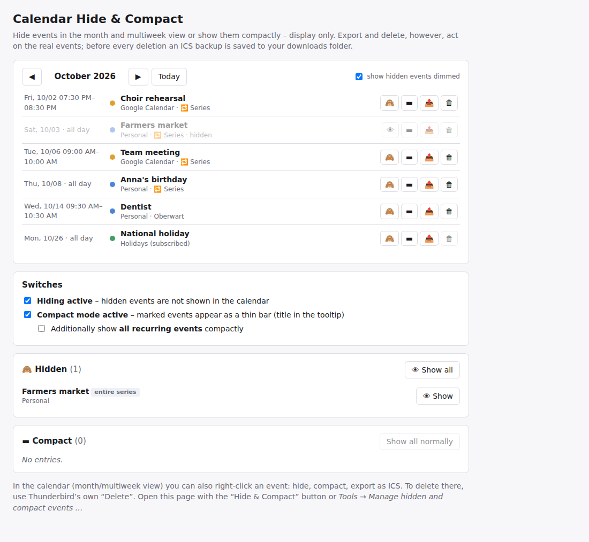

# Calendar Hide & Compact (Kalender-Ansicht)

A Thunderbird add-on that hides events, series or single occurrences in the calendar's month view – or shows them as a thin bar – without changing your calendars. Includes an event manager with a month list.

🇩🇪 [Deutsche Version](README.de.md)



## Why

Recurring events such as waste collection, sunrise times or daily routines can fill the whole month view. This add-on lets you decide what you see.

## Features

- Right-click an event in the month or multiweek view: **Hide series / Hide event / Hide this occurrence only**, **Show compactly** (a thin bar, title in the tooltip), **Export as ICS**.
- Option to show *all* recurring events compactly.
- Management page with a month list: hide 🙈, compact ▬, export 📤 and delete 🗑 (with ICS backup) for every event; switches to turn hiding and compact mode on and off; lists of hidden and compact events to restore them.
- Hiding is display only – the events stay in your calendar, synchronise and remind as usual.
- English and German user interface (following Thunderbird's language). Works offline, sends no data.

Known limitation: affects the month and multiweek views only, not the week and day views.

## Installation

Download the `.xpi` from the [releases](../../releases), then in Thunderbird open *Add-ons and Themes → ⚙ → Install Add-on From File…*.

Requires Thunderbird 128 up to 158. Developed and tested on Windows with Thunderbird 153 ESR and 156.

The add-on is **not listed on addons.thunderbird.net**: it needs its own Experiment API, and Thunderbird currently does not review new add-ons of that kind. New versions are therefore published here; to update, install the newer `.xpi` over the old one (your settings are kept).

After installing there is a *Hide & Compact* button in the toolbar (in all spaces, including the calendar) and an entry in the *Tools* menu (press **Alt** if the menu bar is hidden).

## How it works

Thunderbird has no add-on API for styling or extending the calendar's month view. The add-on therefore uses a small **Experiment API** (`src/api/`) that

- adds a stylesheet and context-menu entries to the month view,
- reads the events of a month, exports events as ICS and deletes events (always with a backup first),
- stores the hide/compact rules in a Thunderbird preference.

The management page and its logic live in `src/ui/`. Everything is removed again when the add-on is disabled. Because Experiments reach into Thunderbird internals, a major Thunderbird update may require an update of the add-on. In the worst case hidden events simply become visible again – no data is changed.

## Building

Plain JavaScript/HTML/CSS, no build step. To create the `.xpi`:

```
python build.py
```

The file is written to `dist/`. For testing you can also load `src/manifest.json` via *Add-ons and Themes → ⚙ → Debug Add-ons → Load Temporary Add-on*.

## Contributing

Bug reports, ideas and translations are welcome – please open an [issue](../../issues). Texts live in `src/ui/i18n.js` (German text is the key, `EN` holds English) and `src/_locales/*/messages.json`.

## Privacy

The add-on sends no data anywhere. See [PRIVACY.md](PRIVACY.md).

## Licence

[MIT](LICENSE) © 2026 Heinz Bundschuh
